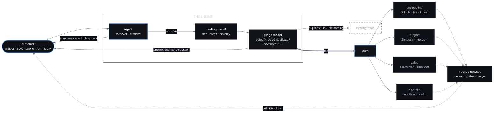

  

  
  
  

  
    <a href="https://supportgeni.us">Site</a> &nbsp;·&nbsp;
    <a href="https://supportgeni.us/#pipeline">Escalations</a> &nbsp;·&nbsp;
    <a href="https://supportgeni.us/llms.txt">llms.txt</a> &nbsp;·&nbsp;
    <a href="https://github.com/SupportGenius/website/issues/13">Backlog</a> &nbsp;·&nbsp;
    <a href="#what-this-does-not-do">What it does not do</a>
  

---

## Support that answers.

When it can't, it routes the issue to the right people, where they already work.

An AI support agent that would answer from a company's own docs, tickets and files, by text or voice,
and turn what it cannot answer into the thing each team works from: a GitHub issue with reproduction
steps for engineering, a ticket for support, a lead for sales. One model would write the ticket and a
second would check it, and the customer would hear back until it is closed.

---

## Two things, and which is which

This matters more than anything else on this page, so it is first.

| | What it is | Status |
| :--- | :--- | :--- |
| **The site** | [supportgeni.us](https://supportgeni.us), in [`SupportGenius/website`](https://github.com/SupportGenius/website): one page, one stylesheet, one script, no build step, on Cloudflare Pages. MIT. | `SHIPPING` |
| **SupportGenius** | The product: the agent, its surfaces, its integrations, the escalation pipeline and the open-source Rust core. Also the waitlist, which opens when its Worker exists. | `PLANNED` |

Nothing beyond the site is built. Not a line of the product. There is no price, published or
estimated, and no vendor named on the site has a partnership with this project.

Two labels are used everywhere, and they govern the tense of the sentence around them:

- `SHIPPING`: built, deployed, usable now. Present tense is allowed only here.
- `PLANNED`: named, not built. Conditional tense, and a chip wherever it appears on the site.

---

## An escalation, as it is designed

The design, drawn. Nothing in this diagram runs yet.

---

## The argument, in five points

**1. Answer only when sure, and show where it came from.** Every reply would cite the doc, ticket or
file behind it. Below a confidence threshold the agent would ask a question or hand off, not guess.

**2. Nothing is filed on one model's say-so.** A drafting model would turn the conversation into a
structured ticket. An independent judge would decide whether it is a real defect, reproducible, a
duplicate, correctly graded, and free of customer data, before anything reaches a team's tools.

**3. Escalations land where each team already works.** Bugs in GitHub, Jira or Linear with
reproduction steps. Support cases in Zendesk. Leads in Salesforce. No new inbox for anyone.

**4. The customer hears back.** The ticket would stay linked to the conversation, and status changes
in those tools would become plain-language updates to the customer until the issue is closed.

**5. A person can step in, and the correction stays.** Someone on call could watch, approve, take over
and hand back from their phone, and their answer would be kept as a reviewed source for the next
customer who asks.

---

## Where it would sit

| Kind | Planned | Status |
| :--- | :--- | :--- |
| `sources` | Docs URL, help center, uploaded files, past tickets | `PLANNED` |
| `surfaces` | Web widget (one script tag, text and voice), iOS and Android SDKs, phone line, REST API, MCP server | `PLANNED` |
| `engineering` | GitHub Issues, Jira, Linear | `PLANNED` |
| `support` | Zendesk, Intercom, Freshdesk | `PLANNED` |
| `sales` | Salesforce, HubSpot | `PLANNED` |
| `people` | Mobile app for whoever is on call, Slack, signed webhooks | `PLANNED` |
| `core` | Ticketing and routing in Rust, one static binary, MIT | `PLANNED` |

---

## What this does not do

Stated here rather than buried, because trust is the whole point.

- **Anything, yet.** There is no agent, no widget, no SDK, no phone line, no API and no MCP server.
- **No integrations.** Every vendor above is a planned destination. None is a partner, and none has
  been asked.
- **No waitlist yet.** It opens when its Worker exists
  ([#2](https://github.com/SupportGenius/website/issues/2)). Until then, write to
  [hello@supportgeni.us](mailto:hello@supportgeni.us).
- **No prices.** Not published, not estimated.
- **No real conversations on the site.** Its illustration, its judge scores and its SLA table are sample
  data, and each is labelled as such.

---

## Roadmap, in public

| Capability | Status | Where |
| :--- | :--- | :--- |
| The site, its `llms.txt`, social card and this profile | `SHIPPING` | [website](https://github.com/SupportGenius/website) |
| Waitlist Worker on the Cratefield harness | `PLANNED` | [#2](https://github.com/SupportGenius/website/issues/2) |
| Privacy notice, then opening the waitlist | `PLANNED` | [#3](https://github.com/SupportGenius/website/issues/3), [#4](https://github.com/SupportGenius/website/issues/4) |
| Self-hosted fonts, CI, an accessibility pass | `PLANNED` | [#6](https://github.com/SupportGenius/website/issues/6), [#8](https://github.com/SupportGenius/website/issues/8), [#9](https://github.com/SupportGenius/website/issues/9) |
| A readable illustration on phones | `PLANNED` | [#7](https://github.com/SupportGenius/website/issues/7) |
| The agent, its surfaces and the Rust core | `PLANNED` | not started |
| A live demo on the site | `PLANNED` | [#12](https://github.com/SupportGenius/website/issues/12), after the agent |

The roadmap is the issue tracker. There is no private version of it. The backlog is written for a
[Colonizer](https://colonizer.dev) colony, or anyone, to take one issue at a time; start at
[#13](https://github.com/SupportGenius/website/issues/13).

---

## Repositories

| Repo | What it is |
| :--- | :--- |
| [**website**](https://github.com/SupportGenius/website) | supportgeni.us: the page, its checks, its images and its deploy script. MIT |
| **.github** | This page, the banner and the mark |

   
  <a href="https://supportgeni.us"><b>supportgeni.us</b></a>
  &nbsp;·&nbsp;
  <a href="mailto:hello@supportgeni.us">hello@supportgeni.us</a>
  &nbsp;·&nbsp;
  a <a href="https://factory0.ventures">Factory Zero</a> venture

  No cookies · no analytics · Support that answers.

